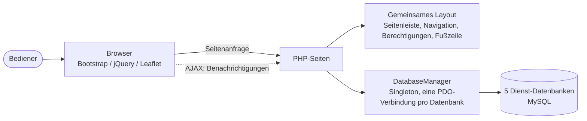

# Überwachungs-Dashboard für Wetterstationen

**Ein webbasiertes Administrations-Dashboard zur Echtzeitüberwachung einer Flotte entfernter Wetterstationen — entwickelt während meines technischen Praktikums (2026).**

[**📸 Screenshots**](#screenshots) · [**🏗️ Architektur**](#architektur) · [**🇬🇧 English**](README.md)

> **Hinweis zur Vertraulichkeit.** Dieses Projekt wurde während meines Praktikums für ein Unternehmen entwickelt. Der Quellcode, das Datenbankschema und alle echten Daten werden in diesem Repository bewusst **nicht** veröffentlicht. Diese Seite dokumentiert das Projekt, seine Architektur und das, was ich beim Entwickeln gelernt habe.

---

## Inhaltsverzeichnis

- [Kontext](#kontext)
- [Überblick](#überblick)
- [Screenshots](#screenshots)
- [Funktionen](#funktionen)
- [Architektur](#architektur)
- [Tech-Stack](#tech-stack)
- [Technische Herausforderungen und Erkenntnisse](#technische-herausforderungen-und-erkenntnisse)
- [Vertraulichkeit](#vertraulichkeit)
- [Autor](#autor)
- [Lizenz](#lizenz)

---

## Kontext

Das Projekt wurde während eines technischen Praktikums in einem Unternehmen entwickelt, das im Bereich **Wetterüberwachung und IoT-Sensornetzwerke** tätig ist. Ziel war ein zentrales **webbasiertes Überwachungs-Dashboard**, mit dem technische Teams eine Flotte entfernter Wetterstationen in Echtzeit überwachen können: Sensormesswerte, Alarme, Zustand der Stationen und Verwaltung von Benutzerzugriffen.

Ich habe das Projekt von Anfang bis Ende bearbeitet: vom Verständnis des bestehenden Backends mit mehreren Datenbanken über den Entwurf neuer PHP-Seiten bis zum Aufbau des Frontend-Dashboards (Karte, Kennzahlen, Alarme, Benachrichtigungen und rollenbasierte Navigation).

---

## Überblick

Das Dashboard ist der zentrale Einstiegspunkt für das technische Team und den Support. Von dort aus kann ein Bediener:

- auf einen Blick sehen, wie viele Stationen online sind, wie viele Alarme aktiv sind und ob alle Backend-Dienste fehlerfrei laufen
- jede Station auf einer interaktiven Karte lokalisieren, farblich nach Status gekennzeichnet
- die Variablen, den Verlauf und die Alarme einer bestimmten Station im Detail aufrufen
- Benutzer, Rollen und Berechtigungen verwalten
- Benachrichtigungen in Echtzeit verfolgen (neue Alarme und Ereignisse)

---

## Screenshots

| Gesamtübersicht und Karte | Stationsliste | Alarmverwaltung |
|---|---|---|
|  |  |  |

---

## Funktionen

### Globales Dashboard (Kennzahlen)

- Live-Zähler: Stationen, erfasste Variablen, aktive Alarme, registrierte Benutzer und Projekte
- Anzeige des Datenbankzustands (X/Y Dienste betriebsbereit, als Verfügbarkeit in Prozent)
- Automatische Aktualisierung mit Zeitstempel „zuletzt generiert um"

### Interaktive Stationskarte

- Erstellt mit **Leaflet.js**; jede georeferenzierte Station wird mit einem farbigen Marker dargestellt:
  - 🟢 Aktiv (zuletzt vor weniger als 1 Stunde gesehen)
  - 🟠 Kürzlich aktiv (vor weniger als 24 Stunden)
  - ⚪ Inaktiv
  - 🔴 Hat einen aktiven Alarm
- Ein Popup pro Station mit Schnellzugriff auf die detaillierten Diagramme und Attribute
- Automatische Anpassung des Kartenausschnitts, sodass alle sichtbaren Stationen im Bild sind

### Alarme und Benachrichtigungen

- Echtzeit-Tabelle der aktiven Alarme, verknüpft mit der Station, die sie ausgelöst hat
- Benachrichtigungsglocke in der oberen Navigation mit Zähler für ungelesene Einträge, Als-gelesen-Markieren (einzeln oder gesammelt), asynchron geladen
- Eigene Seiten zur Alarmverwaltung (erstellen, bearbeiten, löschen)

### Benutzer, Rollen und Berechtigungen

- Rollenbasierte Zugriffskontrolle (RBAC): Jeder Benutzer hat eine Rolle, und jeder Rolle sind bestimmte Module und Seiten zugewiesen
- Die Seitenleiste wird **serverseitig dynamisch gefiltert**, abhängig von den Berechtigungen des angemeldeten Benutzers, sodass Benutzer nur die Module sehen, auf die sie zugreifen dürfen
- Eine Rückfallrolle „Super-Admin" hat Zugriff auf alles

### Berechnete Variablen und automatische Validierung

- Ein separater Dienst verarbeitet abgeleitete Variablen (Formeln, die auf rohe Sensordaten angewendet werden), jeweils mit einem Auslösertyp
- Ein separater Dienst zur automatischen Validierung markiert Auffälligkeiten in eingehenden Daten automatisch

### Administrationswerkzeuge

- Seite für die Systemkonfiguration
- Werkzeuge für Datenexport und Berichte
- Verwaltung von Referenzdaten

---

## Architektur

### Datenbankschicht

Eine einzelne Klasse im Stil eines `DatabaseManager` (Singleton-Muster, eine PDO-Verbindung pro Datenbank, verzögert instanziiert) bündelt alle Verbindungen. Sie stellt eine Prüffunktion `testAllConnections()` bereit, die die Kennzahl „X/Y Datenbanken betriebsbereit" im Dashboard speist.

### Seiten-Template-Muster

Jede Seite folgt einem einfachen Template-/Layout-Muster: Das Seitenskript erstellt seine eigenen Daten und sein eigenes HTML-Fragment (mit `ob_start()`) und übergibt es an eine gemeinsame Layout-Datei. Das Layout rendert darum herum die Seitenleiste, die obere Navigation, die Berechtigungsprüfung und die Fußzeile — so bleibt die gemeinsame UI-Logik an einer Stelle, statt in Dutzenden von Seiten dupliziert zu werden.

---

## Tech-Stack

| Schicht | Technologie | Zweck |
|---|---|---|
| Backend | PHP (PDO, Prepared Statements) | Serverseitige Logik und Datenzugriff |
| Datenbank | MySQL (5 separate Dienst-Datenbanken) | Stationen, Variablen, Alarme, Benutzer und Berechtigungen |
| Frontend | Bootstrap, jQuery, Font Awesome | Responsive Oberfläche und asynchrone Interaktionen |
| Karten | Leaflet.js | Interaktive Stationskarte |
| Authentifizierung | PHP-Sessions, rollenbasierte Berechtigungen | Anmeldung und Zugriffskontrolle |
| Werkzeuge | XAMPP, Adminer, FileZilla | Lokale Entwicklung, Datenbankverwaltung, Dateiübertragung |

---

## Technische Herausforderungen und Erkenntnisse

- **Arbeiten mit fünf Datenbanken statt einer.** Ich habe eine saubere Verbindungsschicht entworfen, sodass jede Seite die richtige Datenbank abfragen konnte, ohne Verbindungslogik zu duplizieren. Jeder Block zum Abrufen von Daten ist defensiv gekapselt, sodass ein einzelner langsamer oder ausgefallener Dienst nicht das gesamte Dashboard lahmlegt: Die Seite wird weiterhin gerendert, dann mit Teildaten.

- **Aufbau eines echten rollenbasierten Berechtigungssystems.** Statt „wenn Admin, zeige X" fest einzucodieren, werden die Berechtigungen pro Rolle aus der Datenbank geladen und dazu verwendet, sowohl zu filtern, was in der Seitenleiste erscheint, als auch, was tatsächlich erreichbar ist, wenn jemand eine Seiten-URL direkt aufruft. Die Logik „Super-Admin sieht alles, alle anderen sehen, was ihre Rolle erlaubt" richtig umzusetzen, ohne Prüfungen überall zu wiederholen, erforderte mehrere Iterationen.

- **Benachrichtigungen mit Echtzeit-Gefühl ohne Websocket-Stack.** Neue Alarme und Ereignisse werden per Polling abgefragt und über leichtgewichtige AJAX-Aufrufe als gelesen oder ungelesen markiert, wodurch Zähler und Dropdown ohne vollständiges Neuladen der Seite aktualisiert werden. Es war eine gute Lektion darin, mit einfachen Mitteln „Echtzeit genug" zu erreichen, wenn eine Push-Architektur nicht gerechtfertigt ist.

- **Effizientes Rendern einer Live-Karte mit Farbcodierung.** Bei potenziell Hunderten von Stationen musste ich darauf achten, wie Marker, Popups und Statusfarben berechnet und eingefügt werden, und dafür sorgen, dass die Karte den Fall ohne georeferenzierte Stationen sauber behandelt, statt eine defekte oder leere Karte zu zeigen.

- **Konsistente Oberfläche über Dutzende von Seiten.** Das Einfügen seitenspezifischer Inhalte in ein gemeinsames Layout zwang mich zu entscheiden, welcher Zustand zu jeder Seite gehört (Titel, Breadcrumbs, zusätzliches CSS und JavaScript) und was wirklich global ist — eine praktische Lektion in der Trennung von Zuständigkeiten in einer Sprache, die sie nicht erzwingt.

---

## Vertraulichkeit

Dieses Projekt wurde während meines Praktikums für ein Unternehmen entwickelt. **Der Quellcode, das Datenbankschema und alle echten Daten werden hier bewusst nicht veröffentlicht**, um die Vertraulichkeit und das geistige Eigentum des Unternehmens zu wahren. Dieses README beschreibt das System, meine Rolle, die Architektur und die technischen Herausforderungen, die ich bewältigt habe, ohne proprietären Code oder Daten offenzulegen.

---

## Autor

**El-Tousy** — Informatikstudentin, Marokko

---

## Lizenz

Veröffentlicht unter der MIT-Lizenz. Siehe [LICENSE](LICENSE) für Details.

---

⭐ Wenn dir dieses Projekt nützlich erscheint, hinterlasse gerne einen Stern.

