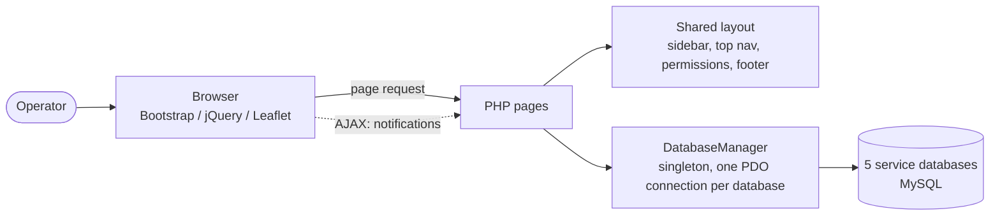

# Weather Station Supervision Dashboard

**A web-based administration dashboard for real-time monitoring of a fleet of remote weather stations — built during my technical internship (2026).**

[**📸 Screenshots**](#screenshots) · [**🏗️ Architecture**](#architecture) · [**🇩🇪 Deutsch**](README.de.md)

> **Confidentiality note.** This project was developed for a company during my internship. The source code, the database schema and any real data are intentionally **not** published in this repository. This page documents the project, its architecture and what I learned while building it.

---

## Table of Contents

- [Context](#context)
- [Overview](#overview)
- [Screenshots](#screenshots)
- [Features](#features)
- [Architecture](#architecture)
- [Tech Stack](#tech-stack)
- [Technical Challenges and Learnings](#technical-challenges-and-learnings)
- [Confidentiality](#confidentiality)
- [Author](#author)
- [License](#license)

---

## Context

The project was developed during a technical internship at a company working in **weather monitoring and IoT sensor networks**. The goal was to build a centralized **web supervision dashboard** that lets technical teams monitor a fleet of remote weather stations in real time: sensor readings, alarms, station health and user access management.

I worked on the project end to end: from understanding the existing multi-database backend, to designing new PHP pages, to building the front-end dashboard (map, KPIs, alarms, notifications and role-based navigation).

---

## Overview

The dashboard is the single entry point for the technical and support team. From it, an operator can:

- See at a glance how many stations are online, how many alarms are active and whether all backend services are healthy
- Locate every station on an interactive map, color-coded by status
- Drill down into a specific station's variables, history and alarms
- Manage users, roles and permissions
- Follow notifications in real time (new alarms and events)

---

## Screenshots

| Global overview and map | Stations list | Alarms management |
|---|---|---|
|  |  |  |

---

## Features

### Global dashboard (KPIs)

- Live counters: stations, tracked variables, active alarms, registered users and projects
- Database health indicator (X/Y services operational, shown as an uptime percentage)
- Auto-refresh with a "last generated at" timestamp

### Interactive station map

- Built with **Leaflet.js**; every geolocated station is plotted with a color-coded marker:
  - 🟢 Active (last seen less than 1 hour ago)
  - 🟠 Recently active (less than 24 hours ago)
  - ⚪ Inactive
  - 🔴 Has an active alarm
- A popup per station with quick links to its detailed graphs and attributes
- Automatic fit-to-bounds so the map always frames all visible stations

### Alarms and notifications

- Real-time table of active alarms, linked to the station that triggered them
- Notification bell in the top navigation with an unread counter, mark-as-read (single or bulk), loaded asynchronously
- Dedicated alarm management pages (create, edit, delete)

### Users, roles and permissions

- Role-based access control (RBAC): each user has a role, and each role is granted access to specific modules and pages
- The sidebar is **filtered dynamically on the server** according to the logged-in user's permissions, so users only see the modules they may access
- A "super admin" fallback role has access to everything

### Calculated variables and auto-validation

- A separate service handles derived variables (formulas applied to raw sensor data), each with a trigger type
- A separate auto-validation service automatically flags anomalies in incoming data

### Administration tools

- System configuration page
- Data extraction and reporting tools
- Reference data management

---

## Architecture

### Database layer

A single `DatabaseManager`-style class (singleton pattern, one PDO connection per database, instantiated lazily) centralizes all connections. It exposes a `testAllConnections()` health check, which powers the "X/Y databases operational" KPI on the dashboard.

### Page template pattern

Each page follows a simple template/layout pattern: the page script builds its own data and HTML fragment (using `ob_start()`), then hands it to a shared layout file. The layout renders the sidebar, the top navigation, the permission check and the footer around it, which keeps shared UI logic in one place instead of duplicating it across dozens of pages.

---

## Tech Stack

| Layer | Technology | Purpose |
|---|---|---|
| Backend | PHP (PDO, prepared statements) | Server-side logic and data access |
| Database | MySQL (5 separate service databases) | Stations, variables, alarms, users and permissions |
| Frontend | Bootstrap, jQuery, Font Awesome | Responsive UI and asynchronous interactions |
| Maps | Leaflet.js | Interactive station map |
| Authentication | PHP sessions, role-based permissions | Login and access control |
| Tooling | XAMPP, Adminer, FileZilla | Local development, database administration, file transfer |

---

## Technical Challenges and Learnings

- **Working across five databases instead of one.** I designed a clean connection layer so that every page could query the right database without duplicating connection logic. Each data-fetching block is wrapped defensively, so a single slow or unavailable service does not break the whole dashboard: the page still renders, with partial data.

- **Building a real role-based permission system.** Instead of hard-coding "if admin, show X", permissions are loaded from the database per role and used to filter both what appears in the sidebar and what is actually reachable when someone requests a page URL directly. Getting the "super admin sees everything, everyone else sees what their role allows" logic right, without repeating checks everywhere, took several iterations.

- **Real-time-feeling notifications without a websocket stack.** New alarms and events are polled and marked read or unread through lightweight AJAX calls, which update the badge and the dropdown without a full page reload. It was a good lesson in delivering "real-time enough" behavior with simple tools when a push-based architecture is not justified.

- **Rendering a live, color-coded map efficiently.** With potentially hundreds of stations, I had to be careful about how markers, popups and status colors were computed and injected, and to make the map handle the case of zero geolocated stations gracefully instead of showing a broken or empty map.

- **Keeping the UI consistent across dozens of pages.** Injecting page-specific content into a shared layout forced me to decide which state belongs to each page (title, breadcrumbs, extra CSS and JavaScript) and which is truly global — a practical lesson in separation of concerns in a language that does not enforce it.

---

## Confidentiality

This project was developed for a company during my internship. **The source code, the database schema and any real data are intentionally not published here**, in order to respect the company's confidentiality and intellectual property. This README describes the system, my role, the architecture and the technical challenges I worked through, without exposing proprietary code or data.

---

## Author

**El-Tousy** — Computer Science student, Morocco

---

## License

Distributed under the MIT License. See [LICENSE](LICENSE) for details.

---

⭐ If you find this project useful, consider leaving a star.

